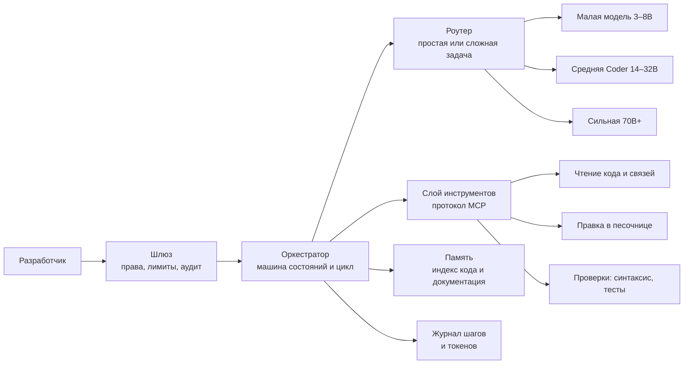
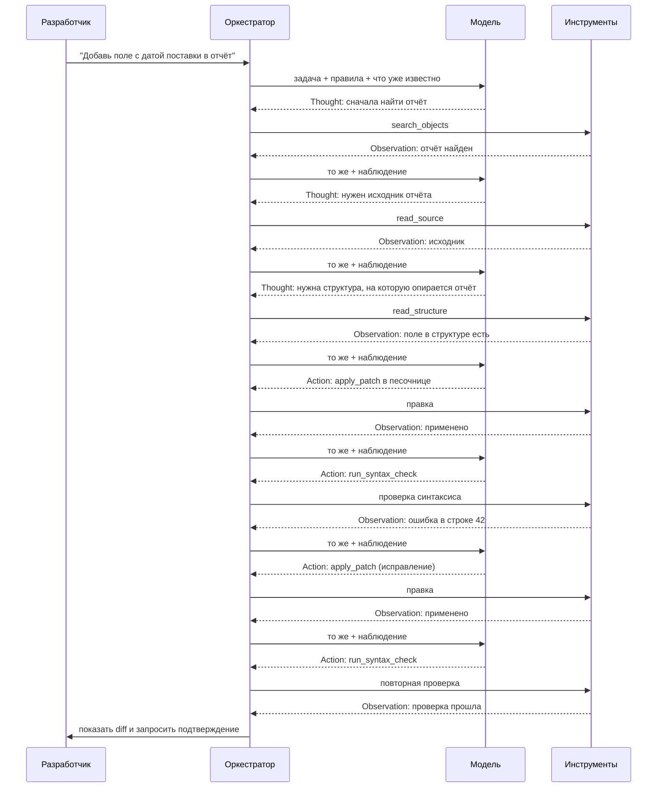
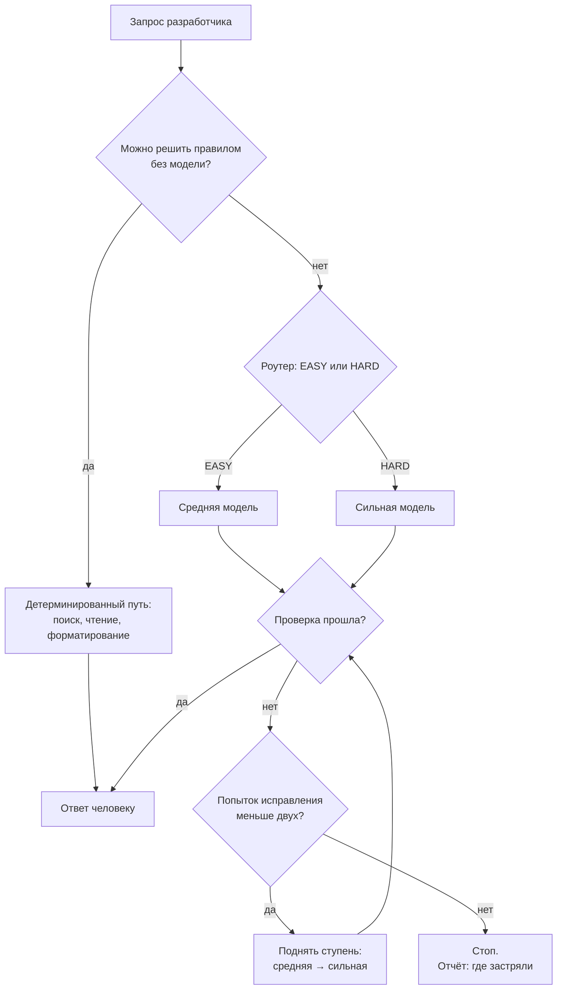

# Агент-помощник ABAP-разработчика

**Лабораторная работа 1. Проектирование архитектуры ИИ-агента**

Кейс: работа с кодом. Предметная область — ABAP в SAP: разработчик тратит много времени на чтение чужого кода, поиск зависимостей, написание и правку объектов. SAP здесь взят как пример закрытого контура; архитектура ниже переносится на любую корпоративную разработку, где исходники нельзя отдавать наружу.

---

## 1. Коротко: что это и как работает

Агент — помощник разработчика, который живёт внутри контура компании и работает с кодом через инструменты, а не через «пересказ по памяти».

Разработчик ставит задачу обычным текстом: «объясни, что делает этот класс», «где ещё используется эта структура», «добавь поле в отчёт», «отрефактори этот метод». Агент не отвечает сразу. Сначала он собирает контекст: находит нужные объекты, читает исходники, смотрит связи. Потом предлагает решение, прогоняет проверки и показывает результат человеку.

Внутри всё время крутится один и тот же цикл: **модель рассуждает → вызывает инструмент → получает результат → снова рассуждает**. Результат инструмента называется наблюдением, и именно он, а не воображение модели, сообщает агенту, что происходит на самом деле.

Моделей в системе несколько. Слабая и быстрая делает рутину: разбирает запрос, выбирает инструменты, сжимает длинные ответы. Средняя пишет код. Сильная берётся за сложные случаи: планирование, межобъектный рефакторинг, финальную проверку. Все модели развёрнуты на своих серверах: исходный код не покидает контур.

---

## 2. Задача и границы

**Что агент умеет.** Четыре режима работы; от режима зависит, какие инструменты доступны и какая модель решает задачу.

| Режим | Что делает | Меняет код? |
|---|---|---|
| **Объяснить** | Читает объект и рассказывает, что он делает, какие у него входы и выходы, где слабые места | Нет |
| **Найти связи** | Ищет, где объект используется, кто его вызывает, что сломается при изменении | Нет |
| **Написать** | Создаёт новый объект по описанию задачи, в песочнице | Да, в песочнице |
| **Отрефакторить** | Переписывает существующий код, показывает разницу построчно | Да, в песочнице |

**Чего агент не делает.** Это не пожелания в промпте, а ограничения на уровне кода:

- не пишет в продуктивную систему и не активирует транспортные запросы — это делает человек;
- не трогает объекты вне разрешённого списка пакетов;
- не читает бизнес-данные из таблиц (только метаданные и код);
- не «додумывает» результат проверки: если проверка не запускалась, он не имеет права утверждать, что код корректен.

---

## 3. Из чего состоит



**Что здесь происходит.** Запрос идёт по цепочке. Шлюз проверяет права и отсекает запрещённые операции. Оркестратор ведёт задачу по шагам и решает, когда цикл закончить. Роутер выбирает модель под сложность задачи. Слой инструментов — единственный способ агента что-то узнать или изменить: напрямую к системе он не подключён. Память хранит индекс кода и документацию, чтобы не читать весь проект каждый раз. Журнал фиксирует каждый шаг — по нему разбирают, почему агент поступил так, а не иначе.

Если описывать агента четырьмя словами из лекции, получается так:

- **Мозг** — модели, которые принимают решения. Их три класса, и они не взаимозаменяемы.
- **Цикл** — оркестратор, который не даёт пропустить шаг и вовремя останавливает работу.
- **Память** — индекс кода и документация. Не «всё, что агент когда-либо видел», а точечная выборка под текущую задачу.
- **Руки** — инструменты: чтение, правка, проверки. Агент не может придумать себе новый инструмент по ходу работы.

**Про инструменты.** Они вызываются по протоколу MCP — это просто способ описать функцию и её параметры так, чтобы модель могла её вызвать. За слоем MCP стоит интеграция с системой разработки (в случае SAP — интерфейс ADT). Для архитектуры это чёрный ящик: нам важны только контракты.

| Инструмент | Что делает | Меняет систему |
|---|---|---|
| `search_objects` | Ищет объекты по имени, типу, пакету | Нет |
| `read_source` | Возвращает исходник объекта | Нет |
| `read_structure` | Возвращает структуру: методы, поля, типы | Нет |
| `find_usages` | Ищет, где объект используется | Нет |
| `read_docs` | Читает документацию и соглашения проекта | Нет |
| `apply_patch` | Предлагает правку в песочнице | Да, только песочница |
| `run_syntax_check` | Запускает проверку синтаксиса | Нет |
| `run_tests` | Запускает модульные тесты | Нет |
| `run_static_analysis` | Запускает статический анализ (в SAP — ATC) | Нет |

**Главное правило:** инструменты чтения доступны всегда, инструменты изменения — только в песочнице и только после того, как собран контекст.

---

## 4. Цикл Reason → Act → Observe



**Что здесь происходит.** Один виток цикла — это один вопрос к модели и одно действие. Модель никогда не выполняет два действия за раз: так понятно, на каком шаге что сломалось.

- **Reason (рассуждение).** Модель объясняет себе, что ей нужно сделать дальше и зачем. Это стоит несколько десятков токенов, но без этого шага модель чаще ошибается инструментом или аргументом — а повторный проход дороже.
- **Act (действие).** Модель выбирает инструмент и параметры. Выполняет вызов не она, а код: модель только просит.
- **Observe (наблюдение).** Результат возвращается в контекст как факт. Ошибка проверки — тоже наблюдение, причём самое ценное: именно оно позволяет агенту исправить себя, а не сдаться.

**Когда цикл заканчивается.** Не тогда, когда «кончились идеи», а по одному из трёх условий:

1. **Цель достигнута** — результат сравнили с тем, что просили: правка применена, проверки прошли, ответ соответствует вопросу.
2. **Нужен человек** — предстоит действие с реальными последствиями: применить правку вне песочницы, активировать объект, изменить структуру данных.
3. **Упёрлись в лимит** — итерации, вызовы инструментов или бюджет исчерпаны. Агент останавливается и честно пишет, на чём именно застрял.

Третье условие важно проговорить отдельно: лимит живёт **в коде оркестратора**, а не в тексте промпта. Просьба «сделай максимум за 10 шагов» моделью не исполняется — она её просто читает.

---

## 5. Один запрос целиком

Чтобы цикл перестал быть абстракцией, разберём типичную задачу.

> «В отчёт по заказам нужно добавить колонку с датой поставки. Поле в структуре есть, в отчёт не выводится.»

**Шаг 1. Разбор запроса.** Роутер смотрит на признаки: меняется существующий объект, затрагивается структура данных, объектов несколько. Это не «объясни» и не «найди» — значит, режим «отрефакторить», сложность высокая. Задачу забирает сильная модель. Будь запрос проще — хватило бы средней.

**Шаг 2. Сбор контекста.** Агент не читает весь пакет. Он делает три точечных шага: находит отчёт по имени, читает его исходник, смотрит структуру, на которую тот опирается. Слабая модель параллельно сжимает длинные ответы инструментов в короткие выжимки — иначе контекст распухнет за пять шагов.

**Шаг 3. План.** Модель формулирует, что собирается менять: добавить поле в описание колонок отчёта, поправить заполнение строки, не трогать структуру. План из трёх пунктов, а не из двадцати.

**Шаг 4. Черновик.** Модель просит применить правку в песочнице. Это ещё не результат — только предложение.

**Шаг 5. Проверка.** Запускается проверка синтаксиса. Она падает: поле не добавлено в описание колонок. Ошибка возвращается как наблюдение. Модель видит не «что-то пошло не так», а конкретную строку и причину.

**Шаг 6. Исправление.** Вторая правка, повторная проверка. Если снова ошибка — агент не долбится в стену: он либо поднимает задачу на ступень выше (если работала средняя модель), либо останавливается с отчётом.

**Шаг 7. Человек.** Проверки прошли, но правка касается рабочего объекта. Агент показывает разницу построчно и ждёт подтверждения. Дальше — активация и транспорт, руками разработчика.

Задача заняла около восьми витков цикла, из них два — на исправление. Это нормальный профиль: без проверок было бы быстрее, но тогда ошибку ловил бы человек.

---

## 6. Какие модели и где

Модели — это спектр, а не «одна хорошая и одна плохая». Каждый класс решает свой тип задач.

| Роль в системе | Класс модели | Пример конфигурации | Почему именно так |
|---|---|---|---|
| **Роутер**: определить тип задачи и сложность | Малая, 3–8B | Instruct-модель на CPU | Нужен мгновенный ответ из одного слова. Большая модель здесь — это очередь и лишние секунды до первого токена |
| **Сжатие и извлечение**: превратить длинный ответ инструмента в выжимку | Малая, 3–8B | Та же модель | Работа механическая, качество проверяется глазами человека по итоговому ответу |
| **Написание и правка кода** | Средняя, 14–32B | Coder-модель | Инженерный стандарт для кодовых агентов: хорошо следует формату вызова инструментов и держит контекст одного-двух объектов |
| **Планирование и сложный рефакторинг** | Сильная, 70B+ | Heavy Reasoning | Задачи, где нужно удержать связи между объектами и не сломать соседний код |
| **Критик**: проверить результат и объяснить, что не так | Сильная, отдельный вызов | Та же модель, другой промпт | Дешёвая модель склонна соглашаться с собой; критик должен быть строже |
| **Поиск по коду и документации** | Модель эмбеддингов | Локальная | Нужна для памяти: найти похожий код и соглашения проекта, не читая всё подряд |

**Зачем вообще делить.** Рутина занимает большую часть шагов: разбор запроса, выбор инструмента, сжатие наблюдений, форматирование. Если отдать это сильной модели, она будет тратить ресурс на перевод строки. Сильная модель включается там, где действительно нужна: план, сложная правка, финальная проверка.

**Слабое место малых моделей.** Они любят ломать формат: добавляют поля, которых нет в схеме; отвечают «MEDIUM», когда допустимо только «EASY» или «HARD»; начинают ответ с «Конечно, вот результат». Поэтому формат ответа ограничивается на уровне движка (constrained decoding — генерация физически не может выйти за схему), а в коде всегда есть ветка «модель ответила что-то не то» с безопасным значением по умолчанию.

**Отдельно про рассуждение.** Если требовать строгий JSON с первого токена, модель перестаёт думать и просто заполняет поля. Поэтому сначала идёт блок рассуждения, и только после него — структурированный ответ. Сначала мысль, потом формат.

---

## 7. Как выбирается модель



**Что здесь происходит.** Решение принимается тремя фильтрами, от дешёвого к дорогому.

**Фильтр 1. Детерминированные правила.** Если задача решается кодом, модель не нужна вообще. Найти объект по имени, прочитать исходник, отформатировать разницу, посчитать строки — это функции. Правило из лекции: всё, что можно сделать детерминированно, делайте детерминированно.

**Фильтр 2. Роутер.** Малая модель смотрит на запрос и признаки задачи и отвечает одним словом: EASY или HARD. Признаки, которые ей передаются: сколько объектов затронуто, меняется ли структура данных, есть ли связи между пакетами, это чтение или запись. Ответ строго ограничен двумя значениями, температура нулевая — роутер должен быть предсказуемым. Если роутер упал или ответил непонятно, выбирается HARD: лучше переплатить, чем тихо ответить плохо.

**Фильтр 3. Подъём по результату.** Роутер может ошибиться, и дешёвая модель может не справиться. Поэтому после каждой попытки работает проверка качества: прошёл синтаксис, прошли тесты, критик не нашёл проблем. Не прошло — задача поднимается на ступень выше, от средней модели к сильной. Это каскад: платим дорого только тогда, когда дешёвого решения не хватило. Минус у него один — задержка растёт с числом ступеней, поэтому ступеней всего две.

**Почему не «пусть большая модель решает всё».** Три причины. Дорого — каждый шаг цикла заново отправляет всю историю. Медленно — тяжёлая модель на длинном контексте отвечает секундами, а цикл делает десяток шагов. И бессмысленно — распознать, что задача про чтение одного объекта, большая модель не лучше малой.

**Если модель недоступна.** Перегруженный сервер отвечает ошибкой или превышает лимит запросов. Агент не должен падать: срабатывает предохранитель (circuit breaker) — после серии ошибок трафик переключается на резервную модель, а когда основная восстановится, возвращается обратно. Если резерва нет, задача встаёт в очередь, а человек получает понятное сообщение, а не таймаут.

---

## 8. Где агент останавливается

Агент без тормозов — это генератор счетов и несчастных случаев. Поэтому ограничения заданы заранее и жёстко.

| Ограничение | Значение | Что происходит при исчерпании |
|---|---|---|
| Витков цикла на задачу | 8 (типично 3–5) | Остановка, отчёт: что успели, что нет |
| Вызовов инструментов | 15 | То же |
| Попыток исправления после неудачной проверки | 2 | Подъём на ступень выше или остановка |
| Бюджет токенов на задачу | Фиксируется на старте | Остановка, в журнале — на каком шаге сгорел бюджет |
| Один и тот же вызов с теми же аргументами дважды подряд | Запрещено | Остановка: агент зациклился |
| Одинаковая ошибка проверки дважды | Сигнал тупика | Смена стратегии или остановка |
| Действия с последствиями | Всегда | Подтверждение человеком |

**Как определяется зацикливание.** Не по счётчику, а по смыслу: если агент вызывает тот же инструмент с теми же аргументами или получает ту же ошибку с тем же текстом — он не движется. Второй такой повтор останавливает цикл. Это дешевле и точнее, чем просто «не больше N шагов».

**Что видит человек при остановке.** Не «произошла ошибка», а конкретику: какой шаг последний, какой инструмент отказал, какая проверка не прошла, что агент уже успел изменить в песочнице.

---

## 9. Спецификация агента

Ниже — компактное описание в том виде, в котором оно живёт в конфигурации: имя, когда срабатывает, что обязан выяснить, алгоритм, проверки, запреты и доступные инструменты.

```
Name:        ABAP-ассистент
Description: Помогает читать, объяснять и менять ABAP-код в закрытом контуре

Triggers:
  - задача сформулирована текстом и касается конкретного объекта или изменения
  - выбран режим: объяснить / найти связи / написать / отрефакторить

Inputs (выяснить до старта):
  - какой объект или пакет затрагивается
  - это чтение или изменение
  - есть ли тесты и проверки для этого объекта

SOP:
  1. Определить режим и сложность
  2. Собрать минимальный контекст: объект, структура, связи
  3. Составить короткий план (не больше 3 пунктов)
  4. Если режим требует изменений — предложить правку в песочнице
  5. Запустить синтаксис, тесты, статический анализ
  6. Если проверки не прошли — исправить (не больше 2 раз), иначе поднять ступень
  7. Показать человеку результат и ждать подтверждения

Checks:
  - правка применена и компилируется
  - тесты проходят
  - изменены только разрешённые объекты
  - в отчёте человеку есть diff и список проверок

Rules (высший приоритет):
  - не писать в продуктив и не активировать транспорт
  - не трогать объекты вне разрешённого списка пакетов
  - не читать бизнес-данные
  - не утверждать, что проверка прошла, если она не запускалась
  - не выполнять два действия за один шаг

Tools: search_objects, read_source, read_structure, find_usages, read_docs,
       apply_patch, run_syntax_check, run_tests, run_static_analysis
```

Порядок здесь не случайный: если алгоритм противоречит правилам, побеждают правила. «Покажи результат» не отменяет «не активируй транспорт».

---

## 10. Как устроен промпт

Промпт собран по принципу «от неизменного к изменчивому»: сначала то, что не меняется никогда, в конце — то, что меняется на каждом шаге.

| Порядок | Блок | Что внутри | Почему здесь |
|---|---|---|---|
| 1 | Системная инструкция | Роль, правила, формат ответа | Не меняется между задачами |
| 2 | Схемы инструментов | Список функций и параметров, всегда в одном порядке | Если порядок «поплывёт», вся дальнейшая часть промпта пересчитается заново |
| 3 | Постоянный контекст | Соглашения проекта, стиль кода, описание архитектуры | Меняется от задачи к задаче, но внутри задачи стабилен |
| 4 | История и запрос | Наблюдения цикла, текущий ввод | Меняется на каждом шаге |

**Почему это важно даже без подсчёта денег.** Модель обрабатывает промпт слева направо и запоминает прочитанное. Если начало осталось тем же, вычисления переиспользуются; если начало изменилось — всё пересчитывается заново. Одна строчка с текущим временем в начале системной инструкции обнуляет эту экономию для всех последующих шагов.

---

## 11. Глоссарий

| Термин | Простыми словами |
|---|---|
| **Агент** | Система, которая не отвечает одним проходом, а многократно чередует рассуждение и действие |
| **Цикл Reason → Act → Observe** | Рассуждай → сделай → посмотри, что получилось |
| **Наблюдение (Observation)** | Фактический результат действия, вернувшийся в контекст модели |
| **Инструмент** | Функция, которую агент может вызвать: прочитать код, применить правку, запустить проверку |
| **MCP** | Протокол, по которому агент описывает и вызывает инструменты |
| **Роутер** | Компонент, который до вызова модели решает, насколько задача сложная |
| **SLM** | Малая языковая модель, 3–8 млрд параметров: быстрая и дешёвая, но простая |
| **Каскад** | Схема «начать с дешёвой модели, при плохом результате перейти к дорогой» |
| **Circuit breaker** | Предохранитель: после серии ошибок трафик уходит на резервную модель |
| **Constrained decoding** | Ограничение генерации схемой: модель физически не может выдать неверный формат |
| **Песочница** | Изолированная среда, где правки можно применять и проверять, не задевая рабочий код |
| **Human-in-the-loop** | Обязательное подтверждение человеком на действиях с последствиями |
